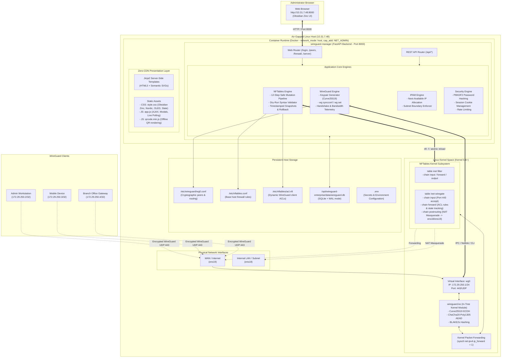
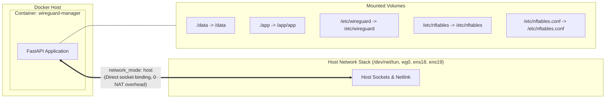
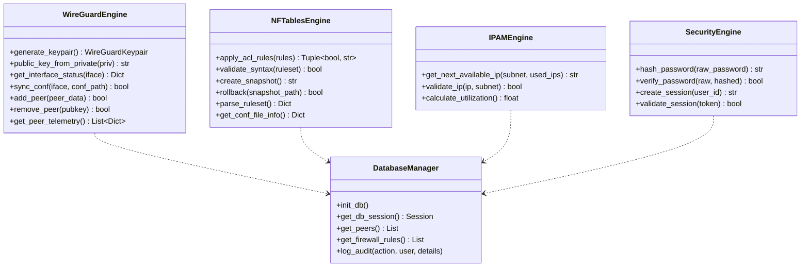
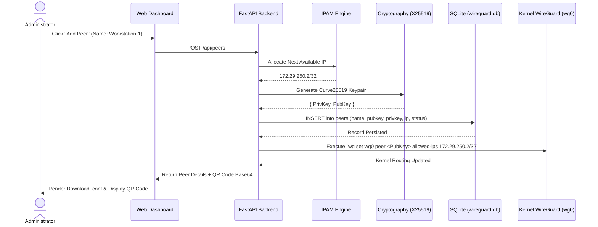
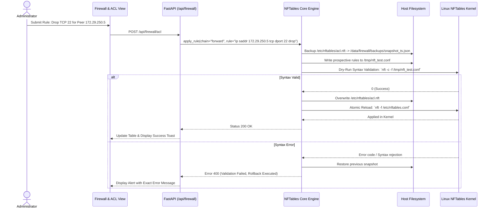
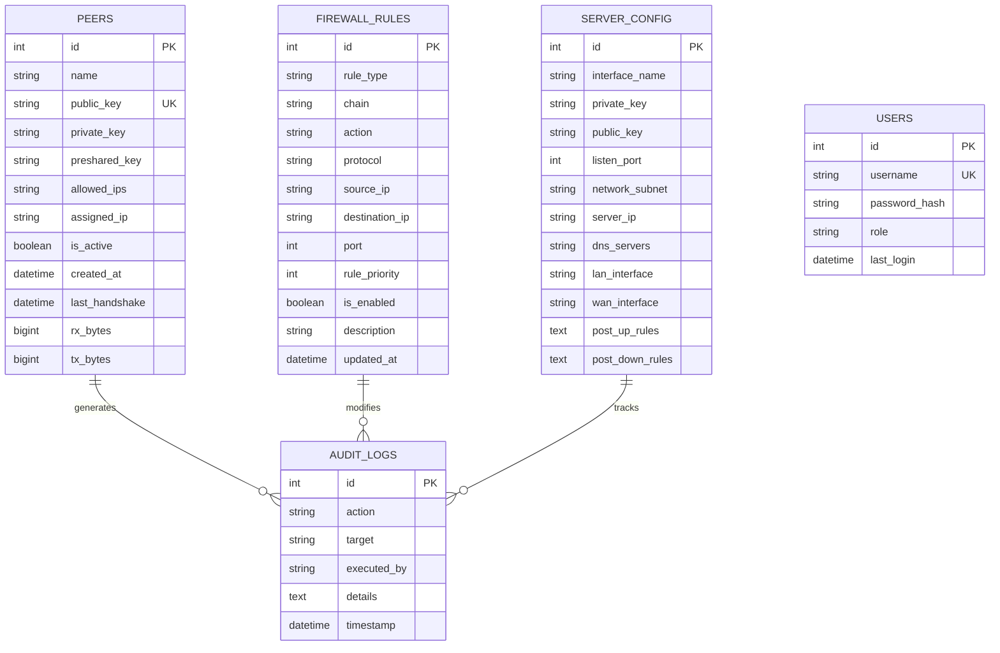

# WireGuard Enterprise - Technical Architecture Specification

## 1. Executive Overview & Architecture Philosophy

**WireGuard Enterprise** is an enterprise-grade, air-gapped VPN gateway and policy management platform. It combines the raw line-rate throughput of the in-tree Linux kernel WireGuard data plane with a modern, containerized Zero-Trust control plane.

### Core Architectural Principles
1. **Separation of Data Plane and Control Plane**:
   - **Data Plane (In-Tree Kernel)**: All packet encryption, decryption, route lookups, and NAT masquerading execute inside kernel space via `wireguard.ko` and `nftables`. No user-space packet copying occurs.
   - **Control Plane (Containerized FastAPI)**: Administrative tasks, peer keypair lifecycle management, telemetry collection, and dynamic firewall rule compilation run inside an isolated Docker container with strict boundaries.
2. **Zero-Trust Network Architecture (ZTNA)**:
   - Granular packet filtering per client `/32` IP address.
   - Strict ingress, egress, and inter-client isolation policies managed via `nftables` atomic transactions.
3. **Air-Gapped & Offline Independence**:
   - 100% self-contained: Zero external CDN dependencies, embedded CSS3/SVG design, local QR code generation, pre-compiled Python wheels, and single-tarball Docker distribution.
4. **Resilient Mutation Pipeline**:
   - 12-step safe mutation pipeline for firewall rules: dry-run syntax verification (`nft -c -f`), atomic commits, automated backup snapshots, and instant rollback on failure.

---

## 2. End-to-End System Architecture



---

## 3. Detailed Architectural Layers

### Layer 1: Physical & Virtual Network Topology

The host is configured with dual physical interfaces and a dedicated virtual tunnel interface:

```
[ Physical LAN: ens18 ] ──┐
                          ├──> [ Linux Kernel Routing / NFTables ] <──> [ wg0: 172.29.250.1/24 (UDP 443) ]
[ Physical WAN: ens19 ] ──┘
```

- **`ens18` (LAN Interface)**: Connects to the local trusted corporate subnet (e.g., `10.31.7.0/24`), enabling routed access to internal servers, databases, and services.
- **`ens19` (WAN / Internet Interface)**: Connects to the upstream gateway or public Internet for client inbound tunnels and outbound masqueraded traffic.
- **`wg0` (Virtual WireGuard Interface)**:
  - **Subnet**: `172.29.250.0/24` (Configurable via `.env`).
  - **Server IP**: `172.29.250.1/24`.
  - **Listen Port**: `443/UDP` (Standard HTTPS port for firewall traversal).
  - **Cryptokey Routing Table**: Maps client public keys to their assigned `/32` IPs (e.g., `172.29.250.2/32`).

---

### Layer 2: In-Tree Linux Kernel Data Plane (`wireguard.ko`)

WireGuard runs directly inside the Linux kernel (kernel version >= 5.6) rather than user-space (such as `wireguard-go` or `openvpn` TUN/TAP):

- **Zero-Copy Network Stack**: WireGuard packets are processed directly within softirq handlers in the kernel networking subsystem, achieving near line-rate speeds (10 Gbps+ capable on modern hardware).
- **Cryptographic Algorithms**:
  - **Key Exchange**: Curve25519 (ECDH)
  - **Encryption & Authentication**: ChaCha20-Poly1305 (AEAD)
  - **Hashing**: BLAKE2s
  - **Key Rotation**: 1.5-minute re-keying timer with forward secrecy.
- **Kernel Routing Flag**:
  - Requires `net.ipv4.ip_forward = 1` persisted in `/etc/sysctl.d/99-wireguard-forward.conf`.

---

### Layer 3: Dynamic NFTables Firewall & Zero-Trust ACL Engine

The firewall architecture uses a modular, two-tier design to prevent configuration collisions:

```
/etc/nftables.conf (Main Host Ruleset)
    │
    ├──> table inet filter (Base host rules: input, forward, output)
    │
    └──> table inet wiregate (WireGuard ruleset)
            ├── chain input (Allows UDP 443, ICMP, established traffic)
            ├── chain forward
            │       │
            │       ├──> include "/etc/nftables/acl.nft" (Dynamic Client-specific ACLs)
            │       │
            │       └──> iifname "wg0" oifname != "wg0" accept
            │
            └── chain postrouting
                    └── ip saddr 172.29.250.0/24 oifname != "wg0" masquerade (NAT)
```

#### The 12-Step Safe Mutation Pipeline (`app/core/nftables.py`)
To prevent network lockouts, syntax errors, or kernel state corruption, any change to firewall rules undergoes a transactional pipeline:
1. **Pre-mutation lock acquisition** (prevents race conditions).
2. **Snapshot creation**: Current `/etc/nftables.conf` and `/etc/nftables/acl.nft` backed up with high-resolution timestamps to `data/firewall/backups/`.
3. **Parse and render**: Generates prospective ruleset with clean comment delimiters (`# WG_MANAGED_START` / `# WG_MANAGED_END`).
4. **Syntax dry-run**: Tests ruleset in user-space using `nft -c -f <tempfile>`.
5. **Atomic write**: Writes valid configuration to target file path.
6. **Kernel apply**: Executes `nft -f /etc/nftables.conf`.
7. **Verification check**: Queries `nft list ruleset` to verify table presence.
8. **Automated rollback**: If any step between 4 and 7 throws an error, the previous snapshot is restored and re-applied within milliseconds.
9. **Audit trail**: Records change event, actor, diff, and outcome in `audit_logs` SQLite table.

---

### Layer 4: Containerization & Isolation Runtime



- **`network_mode: host`**: Bypasses the default Docker bridge network (`docker0`). The container directly interacts with `wg0`, `ens18`, and `ens19`, avoiding double-NAT penalties and allowing native netlink kernel communications.
- **`cap_add: [NET_ADMIN]`**: Grants the container capability to manage network interfaces (`wg`, `ip`), routes, and nftables rulesets without needing fully unconstrained privileged mode.
- **Volume Mounting**:
  - `./data:/data`: Houses SQLite database, encryption keys, and JSON backup states.
  - `./app:/app/app`: Mounts application code for real-time updates without image rebuilding.
  - `/etc/wireguard:/etc/wireguard`: Manages `wg0.conf`.
  - `/etc/nftables:/etc/nftables`: Manages `acl.nft`.
  - `/etc/nftables.conf:/etc/nftables.conf`: Manages host firewall ruleset.

---

### Layer 5: Backend Application Engine (FastAPI / Python 3.12)

The application core is structured into decoupled domain services:



---

### Layer 6: Presentation & Theme Architecture

The user interface follows a modern glassmorphism design philosophy engineered for security operations centers (SOC) and NOC engineers:

- **100% Offline / Zero-CDN**:
  - No external fonts (uses native system typography stack: Inter, `-apple-system`, BlinkMacSystemFont, Segoe UI).
  - All icons are inline SVG vectors (crisp at all DPI scales, zero external network requests).
  - Embedded QR code generation via local `app/static/js/qrcode.min.js`.
- **Multi-Theme Engine**:
  - **Obsidian Zinc (Default)**: Linear & Tailscale inspired dark palette (`#09090b` background, `#27272a` borders, vibrant `#6366f1` accent).
  - **Nordic Frost**: Arctic deep-blue palette (`#0b101b` canvas, `#38bdf8` ice-blue accent).
  - **Midnight OLED**: Ultra-deep pitch black (`#000000` canvas, high-contrast `#10b981` emerald accent).
  - **Light Slate**: Clean daylight mode (`#f8fafc` canvas, `#2563eb` cobalt accent).

---

## 4. Key Sequence Flows

### 4.1 Peer Creation & Kernel Synchronization Flow



---

### 4.2 Firewall Rule Update & Safe Mutation Flow



---

## 5. Database Schema & Data Model

The application uses SQLite in WAL (Write-Ahead Logging) mode for concurrent read operations without locking writes.



---

## 6. Security Architecture & Threat Model

| Security Dimension | Implementation & Mitigations |
| :--- | :--- |
| **Tunnel Cryptography** | Curve25519 ECDH for key exchange; ChaCha20-Poly1305 for authenticated encryption. Re-keying occurs every 1.5 minutes automatically. |
| **Credential Protection** | Admin passwords hashed using PBKDF2 with SHA-256 and salt. Session cookies use `SameSite=Lax`, `HttpOnly`, and cryptographically signed session tokens. |
| **Host Network Attack Surface** | Only UDP port `443` (WireGuard) and TCP port `8000` (Web UI) are opened. No unauthenticated user-space ports are exposed to untrusted networks. |
| **Isolation & Containment** | Control plane operates in a non-root-contained Docker workspace with dropped capabilities except `NET_ADMIN`. |
| **Zero External Telemetry** | Complete air-gap guarantee: No analytics, tracking pixels, CDN scripts, or external font stylesheets. System functions identically with physical network cables disconnected from the Internet. |
| **Denial of Service (DoS) Defense** | WireGuard does not respond to unauthenticated packets (stealth port scanning resistance). Nftables state tracking drops invalid and malformed frames before socket dispatch. |
